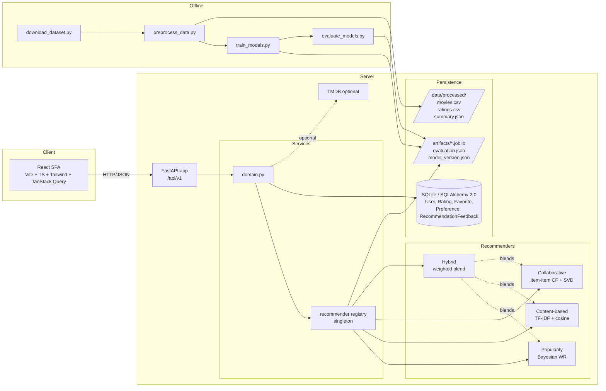
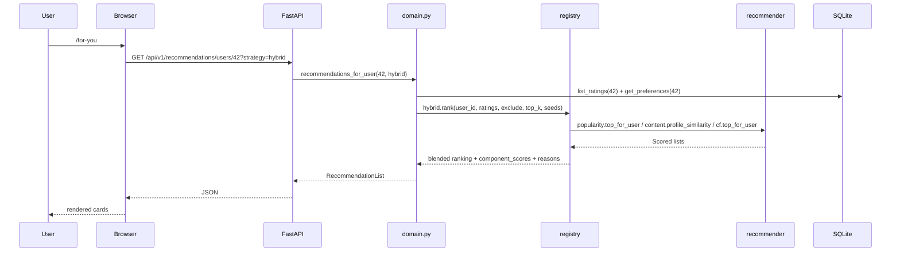

# Architecture

Movie Recommendation System (PROJECT2). Full-stack ML project:
FastAPI backend + React/Vite frontend + offline Python ML pipeline that
produces the recommender artifacts the API loads.

## System diagram

## Request lifecycle

## Module responsibility

| Layer | Files | Owns |
|-------|-------|------|
| Core | `core/{config,logging,exceptions}.py` | Env settings, structured logs, error envelope |
| Persistence | `db/base.py`, `models/db_models.py`, `repositories/repository.py` | SQLAlchemy engine, tables, thin DB reads/writes |
| Schemas | `schemas/schemas.py` | Wire contract in / out |
| ML | `recommender/{base,popularity,content_based,collaborative,hybrid,explanations,registry}.py` | Fit + score + explain |
| Services | `services/domain.py` | Orchestration: catalogue lookup, user context, filter, blend |
| API | `api/routes/all_routes.py`, `main.py` | Routing, middleware, error mapping |
| Offline | `scripts/{download_dataset,preprocess_data,train_models,evaluate_models}.py` | Reproducible pipeline |
| Integration | `integrations/tmdb.py` | Optional metadata enrichment |

## Key design decisions

1. **Catalogue is file-backed, user data is DB-backed.** Movies and ratings
   are loaded once per process from `data/processed/*.csv` via the registry.
   Only user-generated rows (new ratings, favorites, preferences, feedback)
   are persisted to SQLite. This keeps a single source of truth for the ML
   corpus and avoids mirroring 100K rows.
2. **Registry is a process-wide singleton with a lock.** Artifacts load
   lazily on first request; if artifacts are absent the registry falls back
   to fitting in memory from processed CSVs. Both paths converge on the
   same in-memory objects.
3. **Every recommender shares the same interface** (`Recommender.rank() +
   top_for_user()` returning `Scored`); swapping or A/B-ing strategies at
   the route level is a `strategy=` query parameter.
4. **Hybrid normalises independently before blending.** Each component's
   raw scores can be on completely different scales; without min-max
   normalisation the largest-scale component would dominate. Missing
   components (e.g. content on a cold-start user) are dropped and weights
   renormalised, so hybrid degrades gracefully to popularity.
5. **Deterministic ties.** `np.lexsort((movie_ids, -scores))` — same input
   always produces the same output list, so tests and evaluation are
   reproducible.
6. **Explanations only when signals exist.** Content string is emitted only
   if cosine sim ≥ 0.05; collaborative only if CF contributed a positive
   component; popularity only if normalized score ≥ 0.4. Otherwise the
   explanation is honest about the fallback.

## Failure modes and how they're handled

| Failure | Behaviour |
|---------|-----------|
| Artifacts absent at boot | Registry fits on demand from CSVs (slower first request, still correct) |
| Processed CSVs absent | `/ready` reports `catalogue_loaded: false`; recommenders raise `ModelNotTrainedError` → 503 |
| Cold-start user (no ratings, no preferences) | Hybrid falls back to popularity; API returns `personalized=false` and a `notes` array explaining why |
| Unknown movie id | 404 via `NotFoundError` envelope |
| Rating out of 1..5 | 422 via Pydantic validator |
| TMDB disabled (no key) | Silently skipped; poster/overview left null |
| Evaluation not run | `/analytics/model-comparison` returns 503 with instruction to run `evaluate_models.py` |

## Extension points

- Add a new recommender: subclass `Recommender` in `recommender/`, register
  it inside `registry.load()`, add the label to `RecommendationRequest.strategy`
  (Literal) and to the frontend `STRATS` list.
- Swap SQLite → Postgres: change `DATABASE_URL`; Alembic migrations can be
  wired against the same `Base.metadata` (see `docs/deployment.md`).
- Tune hybrid weights: env vars `HYBRID_WEIGHT_POPULARITY`,
  `HYBRID_WEIGHT_CONTENT`, `HYBRID_WEIGHT_CF`; the registry renormalises
  on load, so partial weights are fine.
